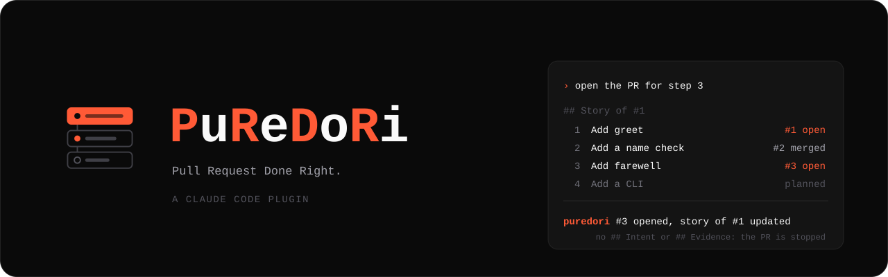

<p align="center">
  
</p>

<p align="center">
  A Claude Code plugin that shapes AI work into small pull requests that a person can review.
  It plans the stack before the code, writes each PR body for the reviewer, and stops a PR without intent and evidence.
</p>

<p align="center">
  <a href="LICENSE"></a>
  <a href="docs/installation.mdx"></a>
  <a href="https://github.com/gabe4coding/puredori/actions/workflows/test.yml"></a>
</p>

<p align="center">
  <a href="#quick-start">Quick start</a> ·
  <a href="docs/usage.mdx">Usage</a> ·
  <a href="docs/installation.mdx">Installation</a> ·
  <a href="docs/development.mdx">Development</a>
</p>

---

An agent writes code faster than a person can review it. The reviewer gets a large diff and a long, generic PR
description. Then the reviewer reads less, or stops.

PuReDoRi changes the shape of the work, not only the text. The reviewer checks the plan before the code and the
behavior after the code. The diff between them is sampled, not read.

- **Plan first**: the agent confirms the intent with you. Then it splits the work into a stack of small PRs. Each
  step names the run output that shows that it works.
- **Story in the first PR**: the first PR holds the plan as a table. While that PR is open, the agent keeps the
  link and the status of each step current.
- **Two-layer PR body**: the top layer has the intent, the drift from it, the decisions and real run output. The
  reading map below it lists the files to sample, from mechanical signals in the diff.
- **Small stays small**: a small diff gets only `## Intent` and `## Evidence`.
- **PR gate**: a hook stops `gh pr create`, and `gh pr edit` with a new body, when the body has no `## Intent` or
  no `## Evidence` section.

## Quick start

You need Claude Code 2.1.296 or later and the GitHub CLI (`gh`), logged in.

Type these commands at the prompt of a Claude Code session:

```
/plugin marketplace add gabe4coding/puredori
/plugin install puredori@puredori
```

Start a new session and give a task that ends in a PR. For example: *"Add a --shout flag to the CLI. It will end
in a PR."* The agent loads the `pr-plan` skill. It asks you to confirm the intent and the steps before it writes
code.

## Example

You confirm a plan of four steps. The agent opens step 1 as a draft PR with this table at the end:

```markdown
| # | Step | Evidence | PR |
|---|---|---|---|
| 1 | Add greet | `greet('Ada')` output | planned |
| 2 | Add a name check | `greet('')` output | planned |
| 3 | Add farewell | `farewell('Ada')` output | planned |
| 4 | Add a CLI | `node cli.js greet Ada` output | planned |
```

Later, step 2 merges and the agent opens the PR of step 3. It reads the table from the first PR, checks the status
of each PR, and changes only the rows that changed:

```markdown
| 2 | Add a name check | `greet('')` output | #2 (merged) |
| 3 | Add farewell | `farewell('Ada')` output | #3 (open) |
```

A reviewer who opens the first PR sees the full stack and its status.

## Documentation

| Page | |
| --- | --- |
| [Installation](docs/installation.mdx) | Requirements, install, local folder, update |
| [Usage](docs/usage.mdx) | The rules, the plan, the PR body, stacks, the PR gate |
| [Development](docs/development.mdx) | Layout, verification loop, checks, release |

## License

MIT. See [LICENSE](LICENSE).
