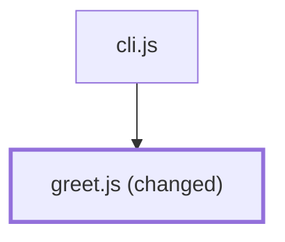

# Usage

You work with Claude as before. The plugin has four parts. Each part acts at a different time:

| Part | When it acts | What it does |
| --- | --- | --- |
| Rules | At session start, on resume, after `/clear` and after compaction | Short rules for PR work, from `hooks/rules.md` |
| `pr-plan` skill | Before code work that ends in a PR | Confirms the intent, plans a stack of small PRs, saves the plan in a draft PR |
| `pr-write` skill | Before `gh pr create` or `gh pr edit --body` | Writes the PR body and keeps the Story table of the stack current |
| PR gate | Each Bash command that writes a PR body | Stops a body without `## Intent` or `## Evidence`, or with too many words |

## The rules

At the start of each session, the plugin adds a short list of rules to the context of Claude. The rules tell Claude
to:

1. Load `pr-plan` before code work that ends in a PR. A one-line fix does not need a plan.
2. Keep one intent per branch, and keep mechanical changes (rename, move, format, generated code, dependency bump)
   apart from logic.
3. Keep real run output in a file while it works. Test output is not run output, because the same agent wrote the
   tests.
4. Tell you when the result drifts from the intent that you confirmed.
5. When it sees code that breaks a standard, propose a lint, type or architecture rule, not a review comment.
6. Load `pr-write` before it opens a PR or changes a PR body.

## Plan the work

When a task ends in a PR, Claude loads `pr-plan` and does these tasks before it writes code:

1. It writes the intent in one or two sentences. You confirm or correct it.
2. It splits the work into steps. Each step has one intent and a small diff, and names its run output.
3. It asks you about the decisions that change what to do next.
4. It writes the plan as a Story table and shows it to you.

When you confirm the intent and the steps, Claude creates the branch of step 1 and opens the first PR as a draft. The
draft holds the intent and the Story table, so a new session or a compaction does not lose them. If you did not allow
pushes in the session, Claude asks before the first push.

Each later step gets its own branch on top of the branch before it. Claude opens its PR when its code is ready, with
the branch before it as the base.

## The PR body

Claude loads `pr-write` before it opens a PR. It reads the diff and decides the size of the PR from these signals:

| Signal | What counts |
| --- | --- |
| Tests changed or deleted | Test files that changed or were deleted, removed or weaker assertions |
| Config | Env, YAML, JSON, build files, CI, feature flags, infrastructure |
| Migrations or schema | Database migrations, schema files |
| Public API | Routes, controllers, API schemas, exported functions and types, events and messages |
| Error handling | Lines that add or remove catch, throw, error returns, retries, timeouts |

Each body follows these rules:

- The text is in ASD-STE100 (Simplified Technical English).
- Under the intent, a vertical Mermaid diagram shows the parts of the system that the change touches. It marks the
  changed parts with a label and a thick border. It does not use a fill without a text color of strong contrast.
- The text outside code blocks has 1000 words or less. Run output and diagrams go in code blocks, so they do not
  count.

A small PR has one concern, about 100 changed lines or less, and no signal. Its body has two sections. In a stack,
it also ends with the Step line (see [Stacks and the Story table](#stacks-and-the-story-table)):

````markdown
## Intent

Add the comment `// Greets a person by name.` as the first line of `greet.js`.



## Evidence

After (`cat greet.js`): ...
````

Any other PR gets the full body:

- **Intent**: what you asked, in words that you can confirm.
- **Drift**: where the result is different from the intent. "None." if there is no drift.
- **Decisions**: only the choices that change the next step, and if the change is easy to roll back.
- **Evidence**: real run output, before and after the change.
- **Reading map**: the paths of each signal in the diff. Use it to choose the files that you read.
- **Stack**: the position of the PR in the stack.

## Stacks and the Story table

Each PR of a stack ends with a line like this one: `Step 3/4 of #1. Previous: #2. Next: add a CLI (step 4).`

The first PR keeps the Story table at the end of its body. When Claude opens or changes the PR of a later step, it
updates the table:

1. It reads the body of the first PR. If the first PR is merged or closed, it does not change it.
2. It sets the row of this step to `#<number> (open)`.
3. It checks the other rows and writes `(open)`, `(merged)` or `(closed)` for each PR.
4. It changes only these rows of the body that it read. Your own edits to the body stay.

## The PR gate

The PR gate is a hook on each Bash command. It finds each `gh pr create` and each `gh pr edit` that writes a body.
Then it reads the body and looks for an `Intent` and an `Evidence` heading (`##` or `###`).

It also counts the words outside fenced code blocks. If the body has more than 1000 words, the gate stops the command.

If a heading is missing, the gate stops the command. Claude gets a message that names the problem. Then
Claude writes the body again and runs the command again.

The gate reads the body from these places:

- `--body` or `-b` with the text in the command
- `--body-file` or `-F` with a file path, or `-F -` with a heredoc
- No body flag on `gh pr create`: an empty body, so the gate stops it

The gate does not run the command, so it cannot see some bodies:

- It does not expand `$VAR` or `$(...)`.
- A body from a pipe or from `<<<` is empty for the gate.
- It reads a body file before the command starts. A file that the same command writes does not exist yet.

For these cases, write the body to a file first. Then run `gh` with `--body-file` and the full path.

The gate does not check these commands:

- A command that only names `gh pr create`, for example in a commit message or a `grep`
- `gh pr create --web`, because you write the body in the browser
- `gh pr edit` without a body flag, for example a change of the title only

The gate is a reminder for Claude, not a security control. It checks the sections and the length, not what the
text says.

### When the gate stops a command

| Message | Cause | Fix |
| --- | --- | --- |
| `the PR body has no "## Intent" or "## Evidence" section` | The body has no such heading | Load `pr-write`, write the body to a file, run the command again with `--body-file` |
| `the PR body has ... words outside code blocks (max 1000)` | The prose of the body is too long | Delete the sentences that the reviewer does not need. Put run output in code blocks. |
| `cannot read the PR body file ...: the path uses a shell variable` | The path has a `$` or a backtick | Use the literal path. If the same command writes the file, write it in a separate step. |
| `cannot read the PR body file ...: the hook reads it before the command runs` | The file did not exist when the command started. For example, the same command writes it, or a `cd` comes before a relative path. | Write the file with the Write tool in a separate step, then run `gh` with its absolute path |
| `the PR gate failed` | An error in the gate | Check the body by hand with `pr-write` |
